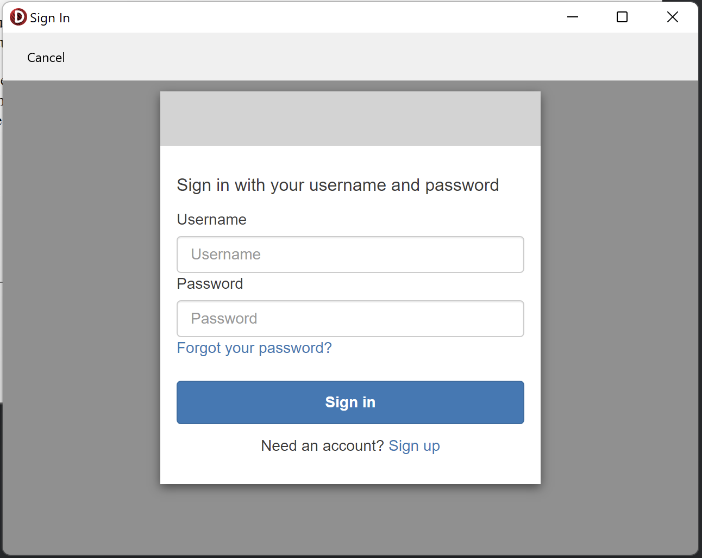
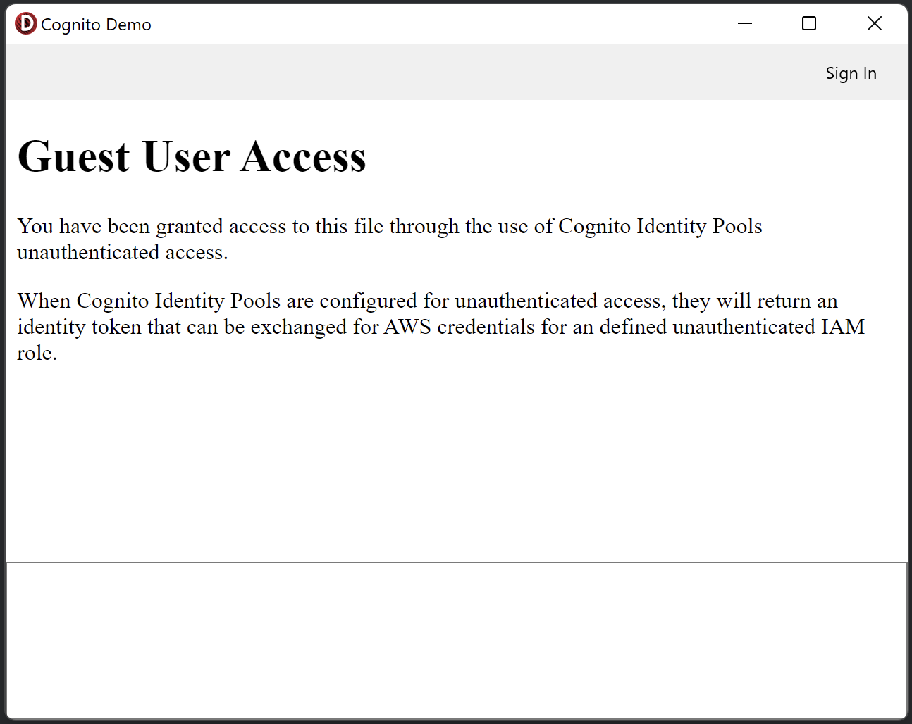
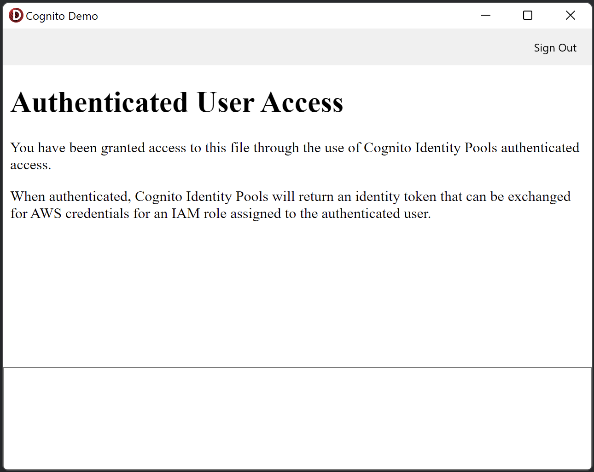

# Amazon Cognito Demo

This demo brings together Amazon Cognito authentication with S3 resource access,
showing how a Delphi app can serve different content to guest users and
authenticated users. It's the most involved sample here, with a CloudFormation
stack, WebView2-based sign-in, and identity pool credential resolution.



## What's demonstrated

- **`TCognitoHostedUI`** component handles the OAuth sign-in/sign-out flow via
  Cognito's Hosted UI, rendered in an embedded WebView2 browser
- **`TCognitoAWSCredentials`** resolves AWS credentials from Cognito identity tokens,
  supporting both authenticated and unauthenticated (guest) flows
- **`TS3Client` with Cognito credentials** shows how to pass Cognito-resolved
  credentials to any AWS service client

### How it works

```
                    ┌─────────────────────┐
                    │  Cognito User Pool  │
                    │    (Hosted UI)      │
                    └────────┬────────────┘
                             │ Identity Token
                             v
┌──────────────┐    ┌─────────────────────┐    ┌──────────┐
│  Guest User  │───>│ TCognitoAWSCreds    │───>│ S3Client │──> Guest Bucket
│  (no token)  │    │ (Identity Pool)     │    │          │
└──────────────┘    └─────────────────────┘    └──────────┘
                             │
┌──────────────┐             │                  ┌──────────┐
│  Signed-in   │─── AddLogin ──────────────────>│ S3Client │──> Known User Bucket
│    User      │                                │          │
└──────────────┘                                └──────────┘
```

Without a token, `TCognitoAWSCredentials` resolves unauthenticated (guest)
credentials, scoped to whatever the guest IAM role allows. After sign-in, the
identity token is added via `Credentials.AddLogin`, and the credentials switch
to the authenticated IAM role with access to different resources.

```pascal
// Create Cognito-based AWS credentials
Credentials := TCognitoAWSCredentials.Create(IdentityPoolId, Region);

// Pass them to any AWS service client
LS3Options := TS3Options.Create;
LS3Options.Credentials := Credentials;
S3Client := TS3Client.Create(LS3Options);

// After authentication, upgrade to authenticated credentials
Credentials.AddLogin(ProviderName, AuthForm.IdToken);
```




## Requirements

- [AWS Account](https://aws.amazon.com)
- Embarcadero [RAD Studio](https://www.embarcadero.com/products/rad-studio) /
  [Delphi](https://www.embarcadero.com/products/delphi)
- [Appercept AWS SDK for Delphi](https://www.appercept.com/products/aws-sdk-delphi)
- [EdgeView2 SDK](https://getitnow.embarcadero.com/edgeview2-sdk/)

## Setup

AWS resources need to be deployed before running the sample.

1. Sign in to the [AWS Console](https://console.aws.amazon.com/).
2. Navigate to the [AWS CloudFormation Console](https://console.aws.amazon.com/cloudformation/home).
3. Create a stack based on the `CloudFormation/IdentityProvider.yml` template.
   Specify a "Stack name" and accept all defaults.
4. Upload `Templates/guests.html` to the `GuestBucket` created by the
   CloudFormation template and rename it to `index.html`.
5. Upload `Templates/known_users.html` to the `KnownUserBucket` created by
   the CloudFormation template and rename it to `index.html`.

## Compiling and running

Once the AWS resources are deployed:

1. Open `Source\CognitoDemo.dproj`.
2. The constants defined in `Settings.pas` correspond to the outputs published
   by the CloudFormation stack. Copy the values from the CloudFormation console.
3. Build the project (don't run it yet).
4. Copy `WebView2Loader.dll` into the build directory.
5. Run the project.

## Costs

The resources used in this demo have costs but are minimal. Some services have a
"free tier" so this demonstration would not incur fees for some of the resources
used. For detailed explanation of potential costs refer to Amazon's pricing
guides for the relevant services:

- https://aws.amazon.com/cognito/pricing/
- https://aws.amazon.com/s3/pricing/

## Cleaning up

After running the demo you will want to clean up the resources created to save
any potential ongoing costs:

1. Navigate to the [Amazon S3 console](https://s3.console.aws.amazon.com).
2. Empty the buckets created as a part of the CloudFormation stack. If you're
   unsure of the buckets created, refer to the "Resources" tab on the
   CloudFormation stack details.
3. Delete the CloudFormation stack.
