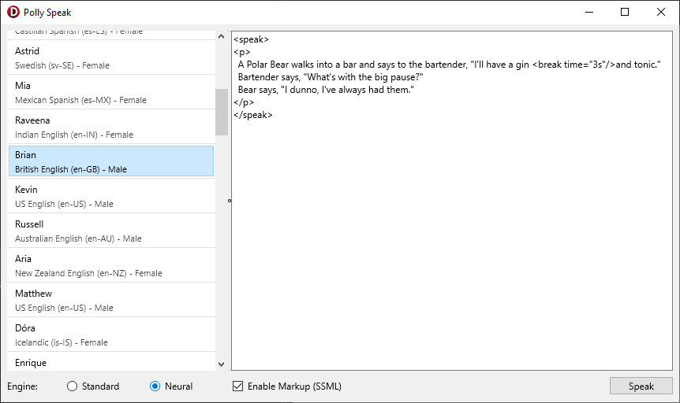

# Polly Speak

Polly Speak demonstrates text-to-speech with Amazon Polly. Browse available voices,
choose between standard and neural engines, optionally use SSML markup, and hear the
results immediately.



## What's demonstrated

- `TPollyClient.DescribeVoices` with pagination via `NextToken`
- `TPollyClient.SynthesizeSpeech` to generate audio
- Standard vs. neural engine selection based on voice capabilities
- Writing the audio response stream to a file for playback

```pascal
Client := TPollyClient.Create;

LRequest := TPollySynthesizeSpeechRequest.Create;
LRequest.Engine := 'neural';
LRequest.OutputFormat := 'mp3';
LRequest.Text := 'Good morning, this is Amazon Polly.';
LRequest.VoiceId := Voice.Id;

LResponse := Client.SynthesizeSpeech(LRequest);
if LResponse.IsSuccessful then
  // LResponse.AudioStream contains the MP3 audio
```

## Running the sample

1. Open "PollySpeak.dproj" in Delphi or RAD Studio.
2. Select "Run \> Run" from the menu or press F9.
3. Select a voice from the list on the left.
4. Choose _Standard_ or _Neural_ if the voice supports it.
5. Check the option to enable markup if you choose.
6. Enter some text to speak in the large memo. Remember to enter valid SSML if
   you've enabled markup.
7. Click **Speak**.

## Using markup (SSML)

Speech Synthesis Markup Language (SSML) can be used to control and enhance
speech generation. If you enable markup, you must, at a minimum, surround the
text with a top-level `speak` tag. For example:

```xml
<speak>
Hello!
</speak>
```

Adding a pause can be achieved by adding a `<break time="3s"/>` tag in the
appropriate place. Check out Amazon's documentation for details on the
[Supported SSML Tags](https://docs.aws.amazon.com/polly/latest/dg/supportedtags.html)
with Amazon Polly.

## Required IAM permissions

- `polly:DescribeVoices`
- `polly:SynthesizeSpeech`
