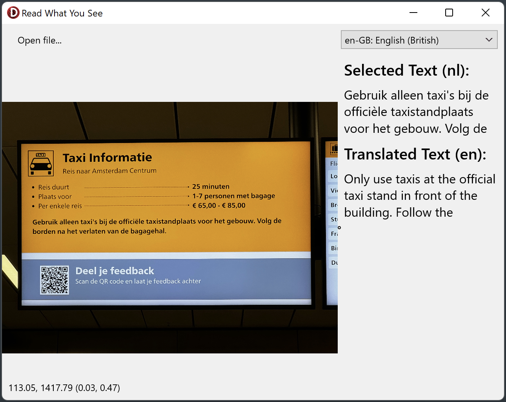

# Read What You See

Read What You See chains three AWS services together: load an image, click on any
text in it, and the app will extract it (Textract), translate it (Translate), and
read it aloud (Polly).



## What's demonstrated

Three services, one interaction:

- **Amazon Textract** — `TTextractClient.DetectDocumentText` to extract text and bounding boxes from the image
- **Amazon Translate** — `TTranslateClient.TranslateText` with automatic source language detection
- **Amazon Polly** — `TPollyClient.DescribeVoices` and `SynthesizeSpeech` to speak the translated text

### Architecture

Each AWS service lives in its own DataModule, keeping the main form focused on
UI and coordination:

| Unit                         | Responsibility                                                             |
| ---------------------------- | -------------------------------------------------------------------------- |
| `DataModules.TextExtraction` | Calls Textract, stores detected blocks, performs hit-testing by coordinate |
| `DataModules.Translation`    | Translates text with automatic source language detection                   |
| `DataModules.TextToSpeech`   | Manages Polly voices and synthesizes speech for the target language        |
| `Forms.Main`                 | Coordinates the above: image display, click handling, language selection   |

### The flow

```
User clicks text in image
        |
        v
TextExtractionDM.SelectTextAt(point)     -- hit-test against Textract bounding boxes
        |
        v
TranslationDM.TranslateText(selected)    -- translate to target language
        |
        v
TextToSpeechDM.ConvertTextToSpeech(text) -- synthesize and play audio
```

## Running the sample

1. Open "ReadWhatYouSee.dproj" in Delphi or RAD Studio.
2. Select "Run \> Run" from the menu or press F9.
3. Click "Open file..." and select an image containing text.
4. Once the image has loaded, click on any text in the image to select it.
5. Choose the output language from the drop-down on the top-left.
6. The selected text will be translated and spoken aloud automatically.

## Required IAM permissions

- `textract:DetectDocumentText`
- `translate:TranslateText`
- `polly:DescribeVoices`
- `polly:SynthesizeSpeech`
