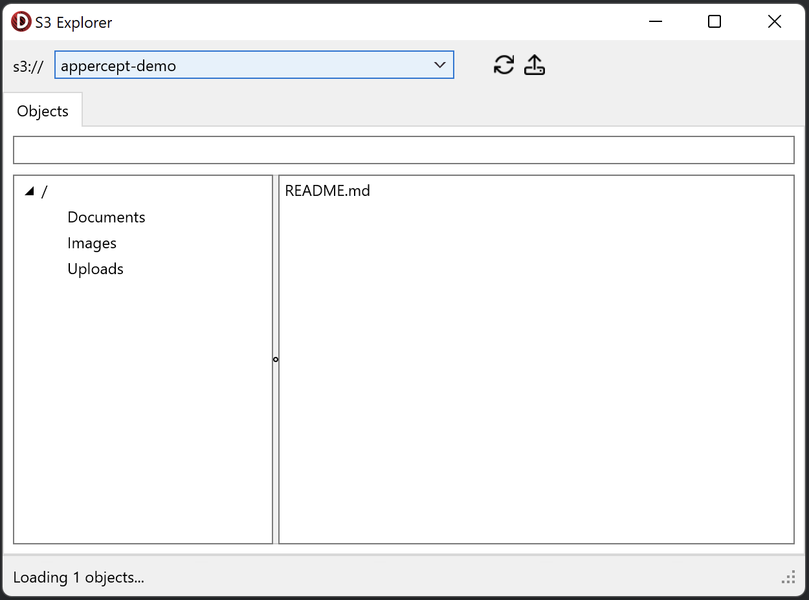

# S3 Explorer

A file-manager-style interface for Amazon S3. Browse buckets, navigate prefix
hierarchies like a filesystem, inspect object details, and upload files — including
large files via multi-part upload with per-part progress tracking.



## What's demonstrated

- `TS3Client.ListBuckets` to list buckets
- `TS3Client.GetBucketLocation` to resolve a bucket's region and create a region-specific client
- `TS3Client.ListObjectsV2` with `Delimiter` and `Prefix` to navigate prefix hierarchies
- The `TS3Bucket` and `TS3Object` convenience models
- Multi-part file uploads via `TS3Object.UploadFile` with per-part progress callbacks
- Object downloads and metadata inspection

```pascal
Client := TS3Client.Create;

// List all buckets
LResponse := Client.ListBuckets;
if LResponse.IsSuccessful then
  for var LBucket in LResponse.Buckets do
    WriteLn(LBucket.Name);

// Navigate a bucket like a filesystem
LRequest := TS3ListObjectsV2Request.Create('my-bucket');
LRequest.Delimiter := '/';
LRequest.Prefix := 'photos/2024/';
LResponse := BucketClient.ListObjectsV2(LRequest);
```

## Running the sample

1. Open "S3Explorer.dproj" in Delphi or RAD Studio.
2. Select "Run \> Run" from the menu or press F9.
3. Select a bucket from the dropdown list at the top.
4. Navigate folders using the tree view on the left and inspect stored objects
   using the list on the right.
5. To inspect the details of an object, double-click it.
6. To upload an object, click the "Upload File..." button on the toolbar.

## Required IAM permissions

- `s3:ListAllMyBuckets`
- `s3:GetBucketLocation`
- `s3:ListBucket`
- `s3:GetObject`
- `s3:PutObject`
- `s3:CreateMultipartUpload`, `s3:UploadPart`, `s3:CompleteMultipartUpload`, `s3:AbortMultipartUpload` (for multi-part uploads)
