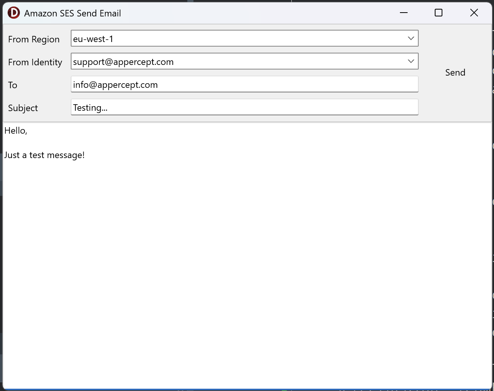

# Send Email (Simple Email Service)

Send emails from Delphi using Amazon Simple Email Service (SES) v2. Select a
verified sending identity, compose a message, and send it.



## What's demonstrated

- `TSESV2Client.ListEmailIdentities` to populate the sender dropdown
- `TSESV2Client.SendEmail` to send the message
- `TSESV2Options` for region-specific client configuration

```pascal
LDestination := TSESV2Destination.Create;
LDestination.AddToAddress('recipient@example.com');

LMessage := TSESV2Message.Create('Subject line');
LMessage.Body.Text := TSESV2Content.Create('Meeting moved to 3pm.');

LRequest := TSESV2SendEmailRequest.Create;
LRequest.Destination := LDestination;
LRequest.FromEmailAddress := 'sender@example.com';
LRequest.Content.Simple := LMessage;

LResponse := Client.SendEmail(LRequest);
if LResponse.IsSuccessful then
  // Email sent
```

## Running the sample

1. Open "SendEmail.dproj" in Delphi or RAD Studio.
2. Select "Run \> Run" from the menu or press F9.
3. Select a region in the "From Region" selector.
4. Select an identity to send from using the "From Identity" selector.
5. Enter a valid email address to receive the message in the "To" input.
6. Enter a subject and write the message content.
7. Click "Send" when ready to send the email.

## Required IAM permissions

- `ses:ListEmailIdentities`
- `ses:SendEmail`

## Further reading

- [Amazon Simple Email Service Developer Guide](https://docs.aws.amazon.com/ses/latest/dg/Welcome.html)
