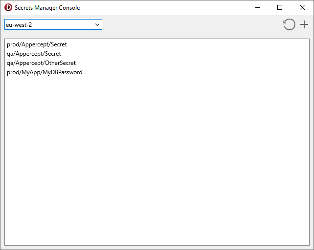

# Secrets Manager Console

Create, list, and retrieve secrets using AWS Secrets Manager, with KMS key
selection for encryption. Also uses AWS Key Management Service (KMS) to list
and describe available encryption keys.



## What's demonstrated

**Secrets Manager** (`TSecretsManagerClient`):

- `ListSecrets`, `CreateSecret`, `DescribeSecret`, `GetSecretValue`

**Key Management Service** (`TKMSClient`):

- `ListKeys` and `DescribeKey` (with pagination)
- `ListAliases` to map key aliases to key metadata (with pagination)

```pascal
LOptions := TSecretsManagerOptions.Create;
LOptions.Region := 'eu-west-1';
Client := TSecretsManagerClient.Create(LOptions);

// Create a secret
LRequest := TSecretsManagerCreateSecretRequest.Create('my-secret', 'super-secret-value');
LRequest.KmsKeyId := LSelectedKey.KeyId;
LResponse := Client.CreateSecret(LRequest);
```

## Running the sample

1. Open "SecretsManagerConsole.dproj" in Delphi or RAD Studio.
2. Select "Run \> Run" from the menu or press F9.
3. Select a region from the list on the top-left.
4. To create a new secret, click the "+" sign on the top-right.
5. To view information or retrieve the secret value, double-click a secret in
   the list.

## Required IAM permissions

- `secretsmanager:ListSecrets`
- `secretsmanager:CreateSecret`
- `secretsmanager:DescribeSecret`
- `secretsmanager:GetSecretValue`
- `kms:ListKeys`
- `kms:DescribeKey`
- `kms:ListAliases`

## Further reading

- [AWS Secrets Manager User Guide](https://docs.aws.amazon.com/secretsmanager/latest/userguide/index.html)
- [AWS Key Management Service Developer Guide](https://docs.aws.amazon.com/kms/latest/developerguide/index.html)
