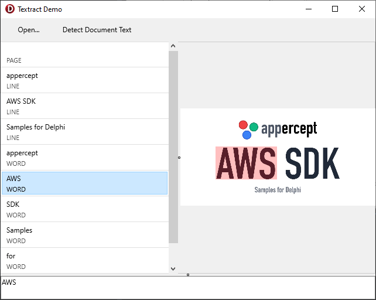

# Textract Demo

Detect and extract text from document images using Amazon Textract. Load an image,
run text detection, then click on detected blocks to highlight them on the original
image with polygon outlines.



## What's demonstrated

- `TTextractClient.DetectDocumentText` to detect text in document images
- `TTextractDocument.FromFile` to load images directly from disk
- `ITextractBlock` response data: text content, block types, and geometry
- Using `ITextractBlock.Geometry.Polygon` to draw outlines on a bitmap

```pascal
Client := TTextractClient.Create;

LRequest := TTextractDetectDocumentTextRequest.Create;
LRequest.Document := TTextractDocument.FromFile('document.png');

LResponse := Client.DetectDocumentText(LRequest);
if LResponse.IsSuccessful then
  for var LBlock in LResponse.Blocks do
    WriteLn(Format('%s: %s', [LBlock.BlockType, LBlock.Text]));
```

## Running the sample

1. Open "TextractDemo.dproj" in Delphi or RAD Studio.
2. Select "Run \> Run" from the menu or press F9.
3. Click the "Open..." button and choose an image file containing text.
4. Click "Detect Document Text".
5. Once the list of detected items is populated on the left, you can select an
   item to highlight on the image.

## Required IAM permissions

- `textract:DetectDocumentText`

## Further reading

- [Amazon Textract Developer Guide](https://docs.aws.amazon.com/textract/latest/dg/what-is.html)
