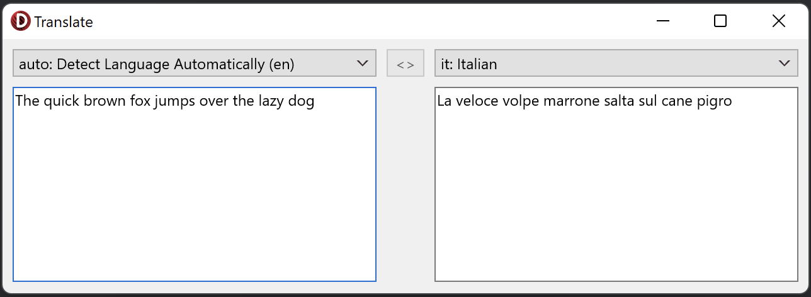

# Translate Demo

Translate text between languages with automatic source language detection,
using Amazon Translate.



## What's demonstrated

- `TTranslateClient.ListLanguages` to populate the language selectors
- `TTranslateClient.TranslateText` to translate input text
- Source language auto-detection by passing `'auto'` as the source language code

```pascal
Client := TTranslateClient.Create;

LRequest := TTranslateTranslateTextRequest.Create('auto', 'fr', 'Hello, world!');
LResponse := Client.TranslateText(LRequest);
if LResponse.IsSuccessful then
begin
  WriteLn(LResponse.TranslatedText);       // "Bonjour, monde !"
  WriteLn(LResponse.SourceLanguageCode);    // "en"
end;
```

## Running the sample

1. Open "Translate.dproj" in Delphi or RAD Studio.
2. Select "Run > Run" from the menu or press F9.
3. Select a target language from the combo list on the top-right.
4. Write some text to translate in the left memo and hit enter to translate.

## Required IAM permissions

- `translate:ListLanguages`
- `translate:TranslateText`

## Further reading

- [Amazon Translate Developer Guide](https://docs.aws.amazon.com/translate/latest/dg/what-is.html)
